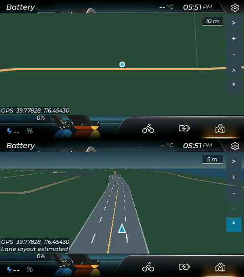

# LVGL 电动自行车仪表盘

同一套 480 × 272 的 SquareLine 界面可以在 Linux PC 上通过 SDL2 运行，也可以编译成 RT-Thread 固件，在 QEMU 的 Cortex-A9 参考板上运行。两个目标都使用仓库锁定的 LVGL 8.3.11。以下命令从仓库根目录执行。


## Linux PC

需要 C 编译器、CMake、pkg-config 和 SDL2 开发包（Ubuntu 的 `libsdl2-dev`）。回放 GPX 轨迹还需要 Python 3。

```sh
git submodule update --init --depth 1 lvgl lv_drivers
cmake -S . -B build
cmake --build build --parallel
```

编译完成后，可用仓库里的北京步行轨迹启动仪表。下例以 4 倍速回放，速度仪表仍显示轨迹原速。

```sh
python3 tools/replay.py --rate 4 | EBIKE_GPS=/dev/stdin ./build/ebike_sim
```

点底栏的地图图标，在右侧小窗点 `*` 进入 5 米自车前视，再点 `-` 即可看到同一位置的 10 米俯视。轨迹起点在公园步道附近，铺装路段和步道会呈现不同的路面。只看仪表界面时，可直接运行 `./build/ebike_sim`。

## RT-Thread

参考目标为 `qemu-vexpress-a9`。Linux 主机需要 CMake、原生 C 编译器、Python 3、SCons、含 newlib 和 libsupc++ 的 Arm 裸机 GCC 工具链，以及 `qemu-system-arm`。Ubuntu 上对应的软件包为 `scons`、`gcc-arm-none-eabi`、`libnewlib-arm-none-eabi`、`libstdc++-arm-none-eabi-newlib` 和 `qemu-system-arm`。制作 QEMU 的 FAT 卡镜像还需要 `dosfstools` 和 `mtools`。

```sh
git submodule update --init --depth 1 lvgl os/rt-thread
./ports/rt-thread/build-qemu.sh -j8
./ports/rt-thread/make-map-sd.sh
qemu-system-arm -M vexpress-a9 -m 128M -kernel build/rt-thread/rtthread.elf \
  -drive file=build/rt-map-tools/map-sd.img,if=sd,format=raw -serial stdio
```

固件启动后会在 QEMU 的 LCD 窗口显示仪表盘，用鼠标点击和拖动即可操作。终端显示 RT-Thread 启动日志及 MSH 命令行。若工具链安装在自定义目录，可在构建前设置 `RTT_EXEC_PATH` 指向包含 `arm-none-eabi-gcc` 的目录。

构建脚本在 `build/rt-thread/` 下准备板级工程。RT-Thread 提供时钟、堆和 LVGL 工作线程，板级包提供 PL111 LCD 与 PL050 鼠标驱动。应用在 `lv_user_gui_init()` 中加载 `ui/`，显示回调把 32 位像素转换为 LCD 使用的 RGB565。

## STM32

STM32 实板适配仍待完成。移植到已有 LVGL 8.3 的 RT-Thread BSP 时，按 `ports/rt-thread/SConscript` 加入 UI、应用和外设适配，在显示和输入设备注册后，从 LVGL 线程调用 `dashboard_start()`。现有素材要求 `LV_COLOR_DEPTH=32`、`LV_COLOR_16_SWAP=0` 和 basic 主题。地图通过 RT-Thread DFS 的 POSIX 文件接口读取。在 BSP 启用 SD 块设备和 FAT 文件系统，将生成的 `beijing.map` 复制到卡上。BSP 负责挂载卡，编译宏 `EBIKE_MAP_PATH` 选择挂载后的文件路径，例如 `"/sd/beijing.map"`。QEMU 参考端口将镜像挂载到根目录，默认读取 `/beijing.map`。

## 离线地图和外设

### 地图操作

点底栏的地图图标，地图默认显示在右侧小窗，左边缘渐变过渡，左侧电量和速度仪表仍可见。右上角短横线标出地面距离，初始比例为 **160 米**。小窗和大图使用相同的缩放档位。

| 按钮 | 操作 |
| --- | --- |
| `<` / `>` | 展开地图或恢复小窗，保留当前位置、比例和视角。 |
| `+` / `-` | 放大或缩小一档，每档相差一倍。**10 米及以上为俯视**，最远到 640 米。从 10 米放大到 **5 米**自动进入自车前视，最近到 **2.5 米**。从 5 米缩小到 **10 米**恢复俯视。 |
| `^` | 俯视时切换北朝上和车头朝上，地名保持正向。从前视返回时恢复原先的俯视朝向。 |
| `*` | 从任意俯视比例直接跳到 5 米自车前视。再点一次，返回进入前视前的俯视比例。 |

**俯视**用蓝点标出有效定位。首次定位前可拖动浏览北京市中心，定位后地图跟随车辆。**自车前视**把车辆箭头放在画面下方，沿行进方向绘制前方弯道和路口，比例尺表示车辆位置的横向地面距离。航向优先取自 GPS 的 RMC 语句，也可从相距至少 3 米的定位点估算。停车时保留最后航向，失去定位时保留视野并隐藏位置标记。

下图是同一 GPX 定位点在 RT-Thread QEMU 上的画面，上方为 10 米俯视，下方为 5 米自车前视。道路走向和相连的路口取自佳明路网。前视中的道宽和分道线按道路类别、单行标记估算，界面以 `Lane layout estimated` 提示。步道绘为窄路面。



### 离线地图数据

PC 和 RT-Thread 构建时均在主机上使用 `app/libgarmin` 解析 `data/Beijing_gmapsupp.img`，将面、线和地点按地理位置分块，写入同一个只读文件 `beijing.map`。仪表运行时，由 `app/mapengine/` 负责可见范围查询、投影和绘制，`app/map_view.c` 负责窗口、按钮和 GPS 状态。

俯视地图先绘制建筑、公园、林地和水域，再叠加路网与地点。地点按类别着色，名称使用原图的拉丁字母拼写，放大后可见公交站、停车场和生活服务点。当前支持定位与地图浏览，地址搜索和路线规划尚未实现。

| 运行平台 | 地图包位置 |
| --- | --- |
| Linux PC | 默认读取 `build/tools/map/beijing.map`。用环境变量 `EBIKE_MAP_FILE` 可指定其他地图包的文件路径。 |
| RT-Thread | 构建生成 `build/rt-map-tools/beijing.map`。QEMU 从虚拟 SD 卡读取 `/beijing.map`，实板路径由 `EBIKE_MAP_PATH` 指定。 |

更换 IMG 或更新地图导出工具后，重新构建以生成新地图包。实板需替换 SD 卡上的文件，QEMU 则重新运行 `./ports/rt-thread/make-map-sd.sh`。

### 瓦片读取与内存预算

空间索引记录面、线、地点的地理范围。引擎按地图窗口、比例和屏幕刷新区域查找要绘制的页，每页最多 4 KiB。视野周围预留八分之一的索引范围，小幅 GPS 移动可复用已有索引。仅在需要绘制时才读取要素页。

- `EBIKE_MAP_CACHE_BYTES` 默认为 96 KiB，限制每个地图实例的索引页、要素页及缓存节点。达到上限时释放最近最少使用的页。关闭地图页后，在下一次仪表刷新时关闭文件并释放缓存。
- `EBIKE_MAP_VIEW_REFS` 默认为 384，每项 28 字节，单独按需分配，最多 10.5 KiB。大范围浏览超出此预算时保留较粗的索引节点，再按刷新区域向下查询。上述预算之外还有文件系统缓存、LVGL 绘制临时区和地点标注。
- 读盘或校验失败会释放当前地图数据。地图页可见时会每隔约 3 秒重试打开文件。恢复挂载并放回有效地图包后可继续浏览，其他仪表独立工作。
- 北京地图包约 18 MB。QEMU 固件 `rtthread.bin` 约 2.98 MB。需要评估更小内存配置时，可在 PC 上运行下列同一组缓存回归，再在目标板测 SD 延迟。首次读入新区仍在 LVGL 线程中执行，实板应测量冷读时的最长刷新耗时，再判断是否需要后台预读。
- 若实板 Flash 更紧张，仪表和设置页的两张背景图可优先评估。它们共 1,044,480 字节，所有像素完全不透明。使用配套的 RGB565 素材与解码路径可节约约 510 KiB。

```sh
cc -std=c11 -O2 tests/map_store_test.c app/mapengine/map_store.c -o build/map_store_test
./build/map_store_test build/tools/map/beijing.map
cc -std=c11 -O2 -DEBIKE_MAP_CACHE_BYTES=16384 -DEBIKE_MAP_VIEW_REFS=16 \
  tests/map_store_test.c app/mapengine/map_store.c -o build/map_store_small_test
./build/map_store_small_test build/tools/map/beijing.map
```

### 外设输入

| 数据 | Linux PC | RT-Thread |
| --- | --- | --- |
| 时间 | 主机本地时间 | BSP 的 RTC 和时区。QEMU 启动时从 PL031 同步 |
| GPS | `EBIKE_GPS` 指定 NMEA 串口或命名管道；`EBIKE_BAUD` 默认 9600，串口为 8N1 | 默认 `uart1`、9600、8N1。板级宏 `EBIKE_GPS_UART`、`EBIKE_GPS_BAUD` 可调整 |
| 温度 | `EBIKE_TEMP` 指向环境温度读数文件，单位毫摄氏度，如 `23500` 表示 23.5 °C | 启用 `RT_USING_SENSOR` 后读取温度设备，默认 `temp0`，可用 `EBIKE_TEMP_DEVICE` 指定注册名 |
| 电量 | `EBIKE_BATTERY` 指向电池剩余百分比文件，取值 0–100 | 电池网关可上报串口百分比；有原生 BMS 驱动的 BSP 可实现 `bool platform_battery(int *percent)`，成功时返回 true |

串口支持带校验和的 NMEA RMC 和 GGA。RMC 的地速用于显示车速，连续的速度样本用于累计本次行程的距离、时间、平均速度和最高速度。行程在重新启动时清零。无定位或连续 5 秒没有新定位时，仪表停止显示当前位置。总里程、续航、充满时间和 ETA 在缺少对应数据时显示 `--`。

如果 GPS 和传感器共用一个网关，同一串口还支持项目定义的句子 `$PEBIK,温度摄氏度,剩余百分比*HH`，行尾为 CR/LF。`HH` 是 `$` 与 `*` 之间各 ASCII 字节异或所得的两位十六进制数。缺失字段可留空，10 秒未刷新即失效。有效的本地温度和电量读数优先。PC 默认只显示系统时间，接入对应数据源后才显示读数。

### 无硬件回放

PC 的启动命令见 [Linux PC](#linux-pc)。`tools/replay.py` 默认读取 `data/Walking_2025-12-07_10-05-38_km.gpx`，按记录的 UTC 时间输出 NMEA 定位，以相邻定位点的距离和时间差计算地速。轨迹读完后回放结束。温度和电量由已配置的数据源提供。

- `--rate 4` 表示四倍速，省略该参数即按原速回放。
- `--gpx 文件路径` 可选择其他带时间戳的 GPX 轨迹。
- `--synthetic` 可选择北京测试环线，同时提供模拟温度和电量。

RT-Thread 使用第二个虚拟串口接收同一组回放。第一个串口的启动日志保存在构建目录。

```sh
python3 tools/replay.py --rate 4 | qemu-system-arm -M vexpress-a9 -m 128M \
  -drive file=build/rt-map-tools/map-sd.img,if=sd,format=raw \
  -kernel build/rt-thread/rtthread.elf -monitor none \
  -serial file:build/rt-thread/console.log -serial stdio
```
